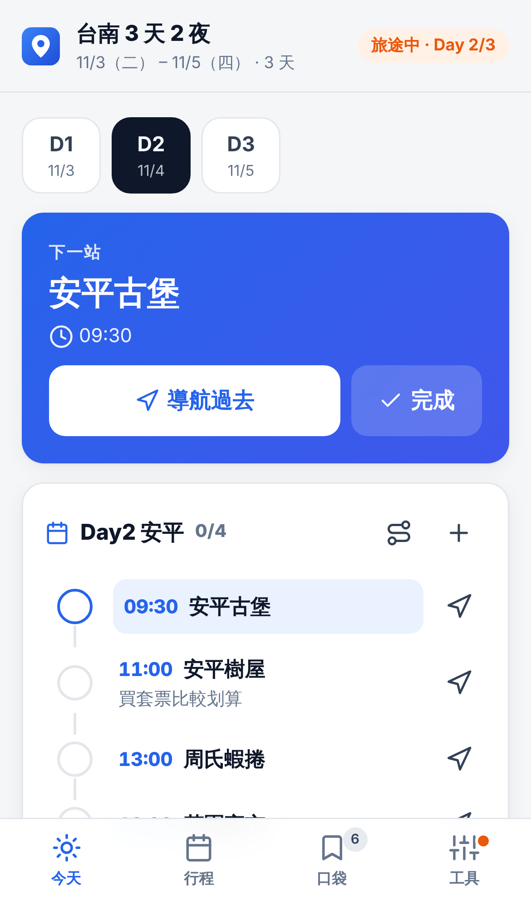
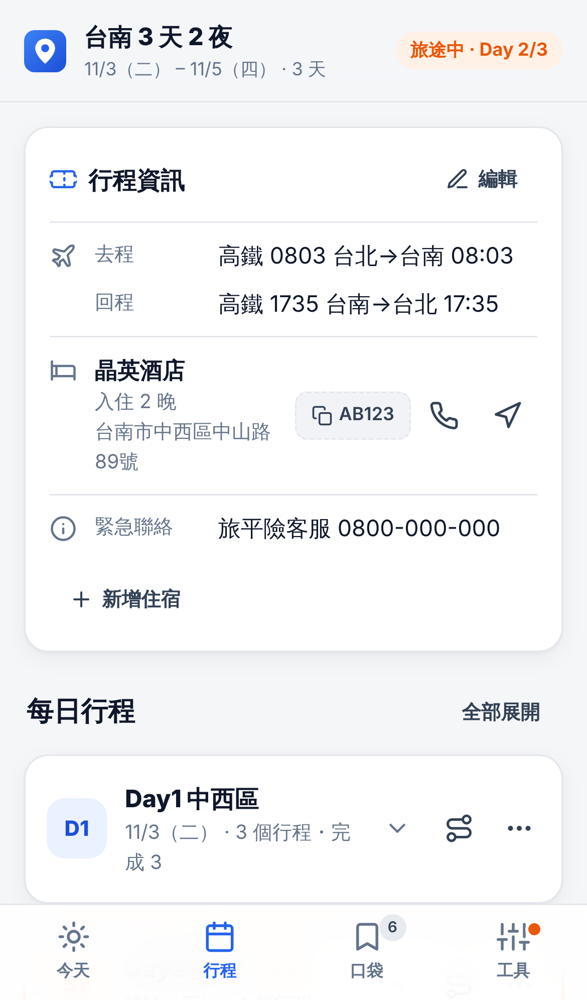
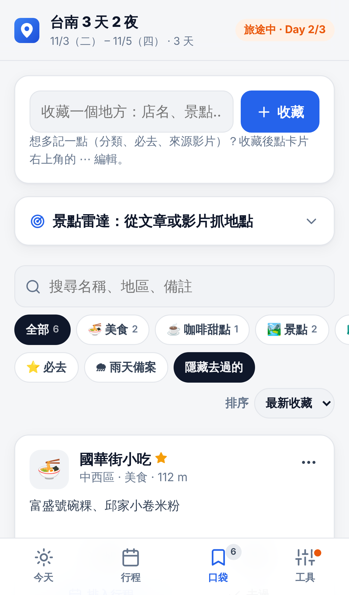
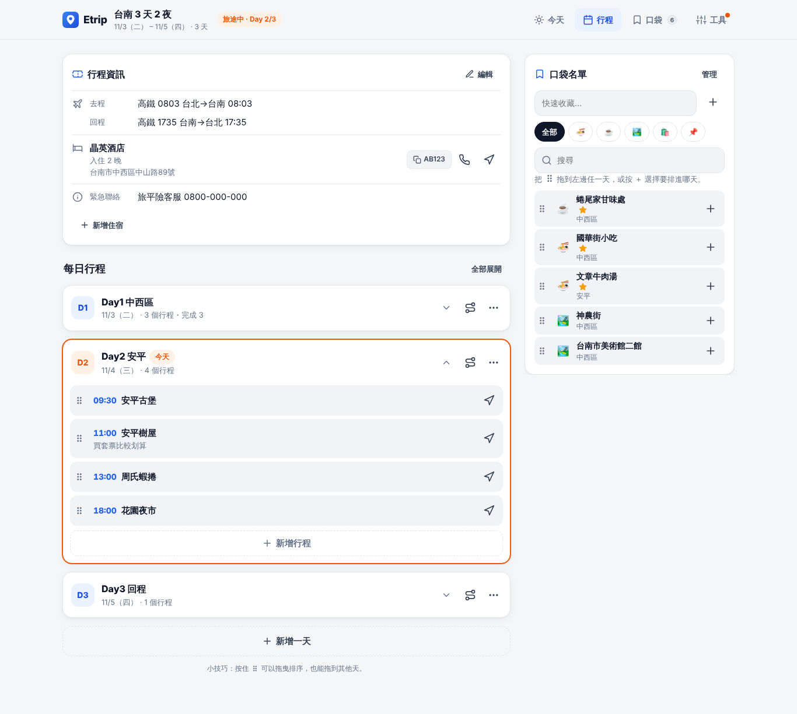

# Etrip 旅遊筆記

行前在電腦上做功課、旅途中用手機隨心所欲。國內、國外旅遊都適用。

## 畫面

| 今天 | 行程 | 口袋 |
|---|---|---|
|  |  |  |

電腦版：

## 四個分頁

| 分頁 | 用途 |
|---|---|
| **今天** | 旅途中打開就會直接跳到當天：「下一站」與導航 → 附近的口袋名單（依目前位置排序、顯示步行時間、可以只看雨天備案）→ 接下來 3 站的時間軸；右下角「＋記帳」隨時記一筆 |
| **行程** | 每天的行程：新增、編輯、拖曳排序（也能拖到別天）、整天路線、依順路排序（可復原）。電腦版右側有口袋名單，可以直接拖進某一天 |
| **口袋** | 所有行程共用的收藏（清單 / 卡片兩種顯示），可依地區分組、一鍵只看「這趟附近」；臨時去了某個地方可以「打卡」，自動記進當天行程並評分：分類（美食 / 咖啡甜點 / 景點 / 購物）、⭐必去、🌧雨天OK、來源連結、筆記，以及「去過 2 次 · 2026/11 九份一日遊 ⭐4」的紀錄。景點雷達可以從 YouTube 影片、文章或影片說明文字抓地點 |
| **工具** | AI 整理行程、雲端同步、備份與匯出、加到主畫面、進階設定（伺服器網址） |

## 旅途中的實用工具

- **國內 / 國外**：依地點自動判斷（也可以在行程設定手動選），國外行程才顯示匯率
- **天氣**：每天依行程地點顯示預報（出發前 16 天內）；降雨機率高時提醒看「雨天備案」
- **匯率小計算機**：當地幣別 ⇄ 台幣雙向換算，匯率每天更新並存在手機裡，沒網路也能算
- **記帳**：金額、幣別、分類、付款方式（現金 / 信用卡 / 電子支付）；外幣記帳當下換算台幣；依付款方式、分類、每天小計；也能在某個地點直接記一筆
- **行李清單**：一日遊 / 國內多日 / 國外範本，可以存成自己的範本（雲端同步）
- **外觀**：自動 / 淺色 / 深色，四種主色

天氣與地名查詢使用 [Open-Meteo](https://open-meteo.com)，匯率使用 [ExchangeRate-API](https://www.exchangerate-api.com)，都是免費服務，從瀏覽器直接取得，不經過自己的伺服器。

## 多個行程與旅行記錄

- 點頁首的行程名稱可以切換行程，分成「旅途中 / 即將出發 / 還沒排日期 / 過去的旅行」
- 建立一日遊、AI 整理、手動建立，都會新增一個行程，不會覆蓋原本的
- 旅程結束後，「行程」頁最上方會出現**旅行回顧**：去了幾個地方、平均評分、相簿連結、「再去一次」
- 每個地點可以打 1～5 顆星、寫一句心得
- 一天裡的地點可以挑幾個「加到其他行程」，例如把一日遊的景點併進下次的三天兩夜

## 分享給朋友：示範模式

把「網址後面加上 `#demo`」的連結傳給朋友，例如 `https://elsiexu.github.io/Etrip/#demo`。
朋友打開會看到兩個範例行程可以隨意操作，資料存在另一個位置，**不會影響他自己的資料**，按「離開示範」就回到原本的畫面。
在「工具 → 使用說明與分享」也可以一鍵分享這個連結。

第一次使用的人會看到歡迎卡片和各頁的小提示（每個只出現一次）；已經在用的人更新後不會看到。

## 雲端同步（同步碼，不用註冊）

1. 電腦：工具 → 雲端同步 → 開啟雲端同步，會得到一組同步碼（例如 `ABCD-EFGH-JKLM`）
2. 手機：掃 QR Code，或在「我已經有同步碼」輸入同一組
3. 之後兩邊的修改會自動同步（修改後約 2.5 秒上傳；打開網站、切回網站時自動下載）

兩台裝置都改過時，以「每個行程 / 每個口袋地點」為單位保留較新的那份，不會整份覆蓋。
同步碼就像密碼，知道的人都能看到你的行程，請不要公開分享。

不想用雲端時，也可以在「工具 → 不用雲端：傳送這個行程」用 QR Code / 連結傳送單一行程，或用備份檔。

## 離線使用（PWA）

在手機上「加入主畫面」後，沒有網路也能打開、查看、編輯行程。AI 整理、景點雷達、補座標、雲端同步需要網路（離線時的修改會在恢復連線後自動上傳）。
更新網站檔案後，請把 `sw.js` 裡的 `CACHE` 版本號 +1，使用者才會拿到新版。

## 檔案結構

```
index.html            頁面骨架
styles.css            樣式（含深色模式、手機 / 電腦版面）
manifest.webmanifest  PWA 設定
sw.js                 離線快取
js/config.js          伺服器網址（Cloud Run 部署後改這裡）
js/utils.js           共用工具（日期、距離、地圖連結）
js/store.js           資料結構（多個行程 + 共用口袋名單）、儲存、合併、舊版資料轉換
js/api.js             呼叫後端
js/sync.js            雲端同步
js/safety.js          資料遺失提醒
js/guide.js           歡迎卡片、小提示、示範模式、使用說明
js/trips.js           我的行程、行程設定、旅行回顧、加到其他行程
js/demo.js            範例行程
js/ui.js              圖示、提示訊息、底部面板、行程資訊卡、外觀設定
js/travel.js          國內 / 國外判斷、天氣、匯率
js/expenses.js        記帳
js/packing.js         行李清單
js/today.js           今天
js/plan.js            行程
js/pocket.js          口袋名單、景點雷達
js/tools.js           AI 匯入、雲端同步、備份、進階設定
js/app.js             啟動與分頁切換
vendor/               SortableJS、lz-string、qrcode-generator（放在本地，離線也能用）
server.py             後端（Flask，部署在 Google Cloud Run）
Dockerfile            Cloud Run 用
DEPLOY.md             搬到 Cloud Run 的一步一步說明
MAINTENANCE.md        後續維護：入口、更新方式、出問題怎麼查、費用
```

## 後端（server.py）

部署方式見 **[DEPLOY.md](DEPLOY.md)**，後續維護與費用見 **[MAINTENANCE.md](MAINTENANCE.md)**。AI 使用 Google Gemini，雲端同步使用 Firestore。

| 變數 | 說明 |
|---|---|
| `GEMINI_API_KEY` | AI 功能（整理行程、抓地點、看 YouTube 影片） |
| `GOOGLE_MAPS_API_KEY` | 補座標（Geocoding API） |
| `ALLOWED_ORIGINS` | 只允許自己的網站呼叫，例如 `https://elsiexu.github.io`（不設定 = 全部允許，別人可能用掉你的額度） |
| `GEMINI_MODEL` / `GEMINI_VIDEO_MODEL` | 選填，預設 `gemini-3.5-flash-lite` |
| `AI_PROVIDER` | 選填，設成 `openai`（搭配 `OPENAI_API_KEY`）可以改回 OpenAI，但不支援影片 |

---

### 2026-11 更新（第五批：導覽與分享）

- 第一次打開的歡迎卡片、各頁的情境小提示（看過就不再出現，既有使用者不顯示）
- 示範模式（網址加 `#demo`），範例資料和自己的資料分開存
- 「工具 → 使用說明與分享」：再看一次說明、重新顯示小提示、分享示範連結

### 2026-11 更新（第四批：使用體驗）

- 資料只存在瀏覽器時提醒開啟雲端同步（iPhone Safari 可能清掉網站資料）
- 「今天」頁改成下一站 → 附近 → 時間軸（只顯示接下來 3 站），加上「＋記帳」浮動按鈕
- 口袋名單清單模式、篩選收進一個按鈕、收藏與景點雷達合併成一張卡片
- 「去過」改成打卡：記進當天行程並評分，旅行回顧也看得到
- 快速收藏時用地址自動補上地區；距離旁顯示步行時間
- 最小字體 12px、按鈕至少 40px

### 2026-11 更新（第三批）

- 天氣預報、匯率小計算機、國內 / 國外模式
- 記帳（付款方式、分類、外幣換算），旅行回顧顯示總花費
- 行李清單與自己的範本
- 口袋名單依地區分組、只看這趟附近
- 外觀設定：深淺模式與四種主色

### 2026-11 更新（第二批）

- 後端搬到 Google Cloud Run（不用再等 30～60 秒喚醒），AI 改用 Gemini
- 景點雷達可以直接貼 YouTube 影片網址，AI 看完影片找出地點
- 多個行程：一日遊、AI 整理都會新增行程，不再覆蓋；過去的旅行會保留下來
- 旅行回顧：評分、心得、相簿連結、「再去一次」
- 一日遊挑幾個點「加到其他行程」
- 口袋名單變成所有行程共用，並顯示去過的紀錄
- 雲端同步碼：電腦和手機自動同步，不用註冊帳號
- 一次只顯示一則提示，避免誤按舊提示的「復原」

### 2026-11 更新

- 手機版改成底部分頁，打開就是「今天」；編輯改用網頁內的面板，不再跳出 prompt 視窗
- 新增：今天模式、附近的口袋名單（定位）、口袋名單分類 / 必去 / 雨天 / 來源連結 / 去過了、行程資訊卡（交通、住宿、訂位代號、緊急聯絡）、QR Code 同步、JSON 備份還原、離線 PWA、深色模式、刪除可復原
- 修正：AI 匯入不再打亂你的時間順序、不再整份覆蓋（可選「加在後面」）、景點雷達重複加入、匯出時飯店顯示「未設定」、倒數改為「還有 N 天」、Render 伺服器喚醒時的提示與錯誤處理
- 舊版資料會自動轉換，不會遺失
